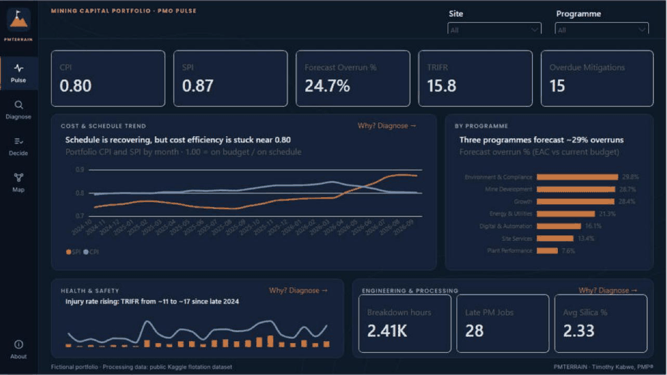
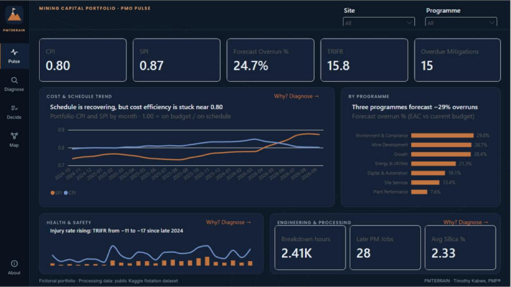
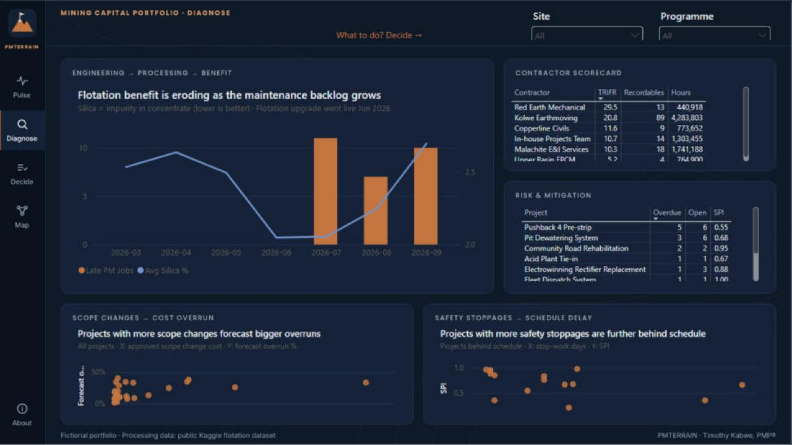
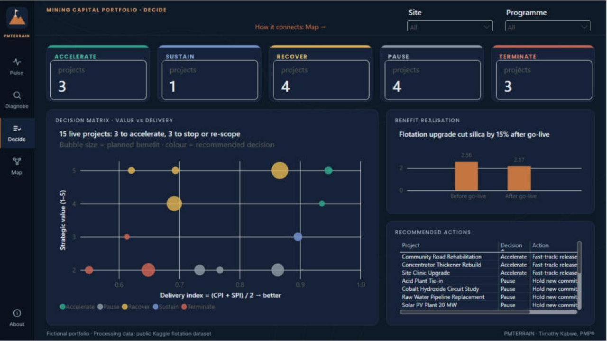
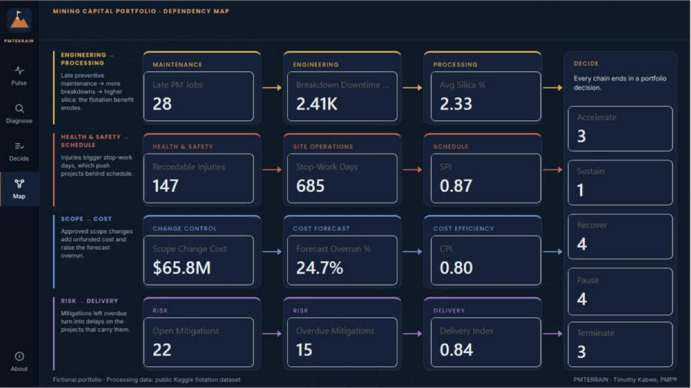
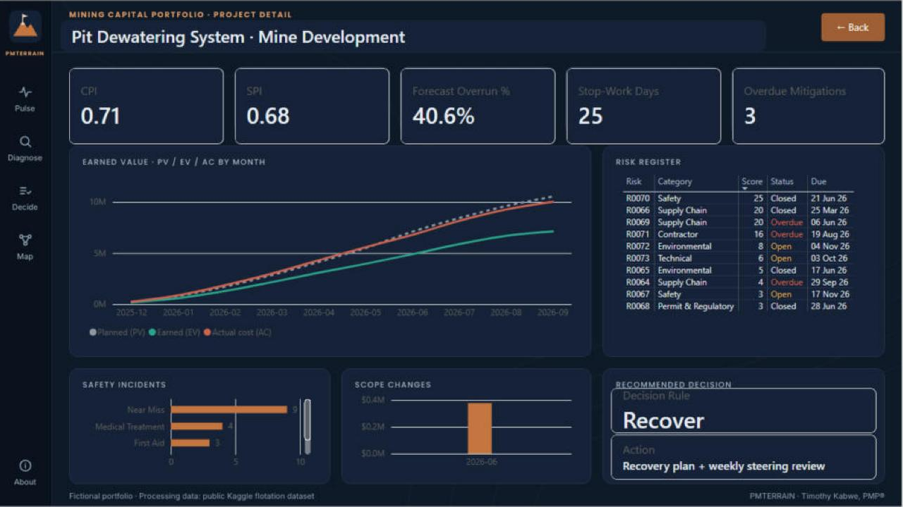
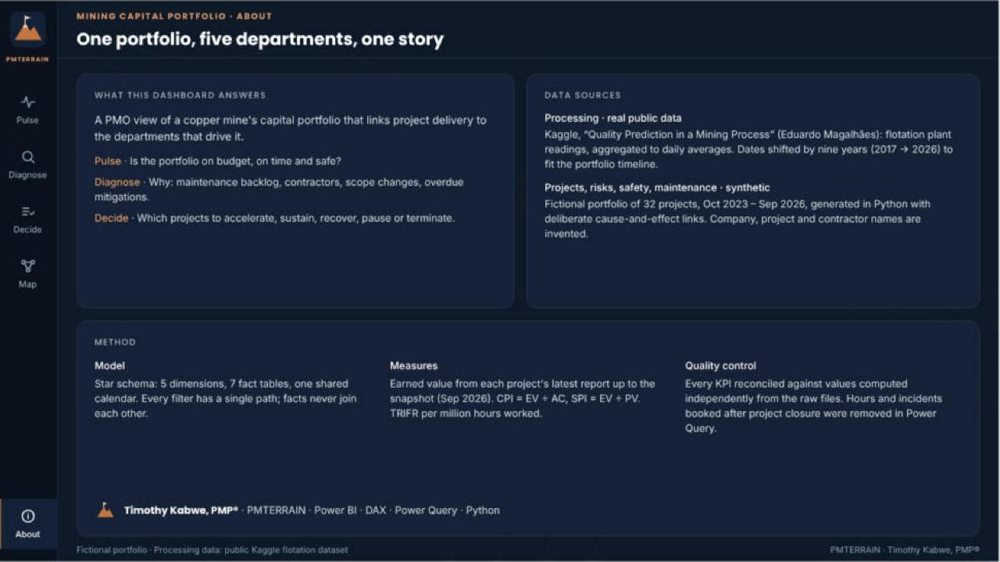
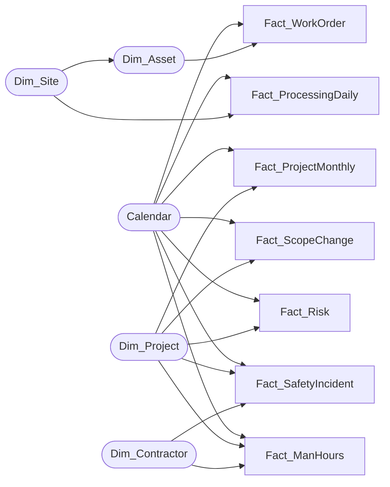

# Mining PMO Portfolio Dashboard (Power BI)

A PMO dashboard for the capital project portfolio of a copper mine, connecting **project delivery** to the departments that drive it: **Engineering & Maintenance, Processing, Health & Safety, Risk and Change Control**.

It follows a **Pulse → Diagnose → Decide** flow. The portfolio's health comes first, then the root causes, then a recommended decision for every live project.



> Built by **Timothy Kabwe, PMP®** · Power BI · DAX · Power Query · Python
> The portfolio is fictional. The processing data is real (public Kaggle dataset). See [Data](#data).

---

## The story the data tells

| Question | Answer (snapshot: 30 Sep 2026) |
|---|---|
| Is the portfolio on budget? | **No.** CPI **0.80**, and the forecast is **24.7%** over budget (≈ $141M). |
| Is it on time? | **Behind but recovering.** SPI rose from 0.74 to **0.87** over two years, while CPI stayed flat near 0.80. |
| Is it safe? | **Worsening.** TRIFR is **15.8** per million hours, up from ~11 to ~17 since late 2024. Worst contractor: Red Earth Mechanical (29.5). |
| Why? | Late preventive maintenance (**28** jobs) eroded the flotation benefit. Projects with more scope changes forecast bigger overruns (r = 0.46). Among projects behind schedule, more safety stop-work days go with a lower SPI (r = −0.41). **15** risk mitigations are overdue. |
| What should we do? | Of 15 live projects: **3 Accelerate · 1 Sustain · 4 Recover · 4 Pause · 3 Terminate**. |
| Did the flotation upgrade pay off? | **Yes, but it is eroding.** Silica in concentrate fell from 2.56% to 2.17% (−15%) after go-live, then rose again as the maintenance backlog grew. |

## Pages

| Page | What it shows |
|---|---|
| **Pulse** | KPI row (CPI, SPI, forecast overrun, TRIFR, overdue mitigations), cost & schedule trend, overrun by programme, safety trend, engineering & processing cards |
| **Diagnose** | Maintenance backlog vs. silica (flotation benefit), contractor safety scorecard, risk & mitigation table, scope changes → cost overrun, safety stoppages → schedule delay |
| **Decide** | Decision cards, value-vs-delivery matrix (bubble = planned benefit), benefit realisation, recommended actions |
| **Map** | Dependency map: four cause-and-effect chains across departments, each with live KPIs and ending in the portfolio decision |
| **Project Detail** | Drill-through page for any project: KPIs, PV / EV / AC curve, risk register, incidents, scope changes, recommended decision |
| **About** | Purpose, data sources and method |

| Pulse | Diagnose |
|---|---|
|  |  |
| **Decide** | **Map** |
|  |  |
| **Project Detail (drill-through)** | **About** |
|  |  |

## How the pages connect

- **Synced slicers**: Programme and Site filter Pulse, Diagnose and Decide together.
- **Drill-through**: right-click any project on any page → *Drill through → Project Detail*. A **Back** button returns you to where you were.
- **Story links**: *Why? Diagnose →* on Pulse panels, *What to do? Decide →* on Diagnose, *How it connects: Map →* on Decide.
- **Navigation rail**: Pulse · Diagnose · Decide · Map · About on every page (*Ctrl + click* in Power BI Desktop).

## Data model

Star schema: **5 dimensions, 7 fact tables, 17 one-to-many single-direction relationships**. Facts never join each other, so every filter has a single path.



Maintenance and processing are linked to the portfolio through **Site → Asset**, not through projects, so selecting a project does not filter them (by design).

## Key techniques

- **Snapshot earned value**: EV, AC, PV, BAC and EAC are cumulative, so each measure reads every project's *latest report on or before the snapshot date* (`SUMX` over projects + `CALCULATE` with `REMOVEFILTERS('Calendar')`) instead of summing months. See [`dax/measures.dax`](dax/measures.dax).
- **Decision rule** in DAX, from strategic value (1–5), CPI, SPI and status:

  | Decision | Rule |
  |---|---|
  | Accelerate | Value ≥ 4, CPI ≥ 0.90 and SPI ≥ 0.90 |
  | Recover | Value ≥ 4, delivering below that |
  | Terminate | Value ≤ 3 and (CPI < 0.75 or SPI < 0.60) |
  | Sustain | Value ≤ 3, CPI ≥ 0.85 and SPI ≥ 0.85 |
  | Pause | Everything else |

  The thresholds are documented business rules for a steering committee to agree, not an industry standard. Change them in `Decision Rule`.
- **Data-quality fix in Power Query**: man-hours and incidents booked after a project stopped reporting are removed (507 → 450 and 750 → 669 rows). See [`powerquery/transformations.md`](powerquery/transformations.md).
- **Reconciliation**: every KPI was checked against values computed independently in Python from the raw CSVs. A hidden *QA – Reconciliation* page in the report holds the test visuals.
- **Design**: custom dark theme ([`PM_Terrain_Dark.json`](powerbi/PM_Terrain_Dark.json)) and 1280×720 page backgrounds, with insight-style chart titles that state the conclusion.

## Data

| Source | Tables | Notes |
|---|---|---|
| **Real, public**: Kaggle [*Quality Prediction in a Mining Process*](https://www.kaggle.com/datasets/edumagalhaes/quality-prediction-in-a-mining-process) (Eduardo Magalhães Oliveira, CC0 Public Domain) | `Fact_ProcessingDaily` | Flotation plant readings averaged per day (Mar–Sep 2017), dates shifted by nine years to 2026 to fit the portfolio timeline |
| **Synthetic** (Python, seed 42) | All other tables | 32 projects, Oct 2023 – Sep 2026, with deliberate cause-and-effect links. Company, project and contractor names are invented. |

Row counts (raw CSV): Dim_Project 32 · Dim_Site 6 · Dim_Contractor 6 · Dim_Asset 16 · Fact_ProjectMonthly 456 · Fact_ScopeChange 68 · Fact_Risk 239 · Fact_SafetyIncident 750 · Fact_ManHours 507 · Fact_WorkOrder 1,573 · Fact_ProcessingDaily 171.

## Repository structure

```
mining-pmo-dashboard/
├── powerbi/
│   ├── Mining_PMO_Dashboard.pbix     # the report
│   ├── PM_Terrain_Dark.json          # Power BI theme
│   └── backgrounds/                  # 1280×720 page backgrounds
├── data/                             # 11 CSV tables loaded by the report
│   └── source/flotation_daily_2017.csv
├── scripts/
│   ├── prepare_kaggle.py             # Kaggle raw file -> daily averages
│   └── generate_data.py              # builds all 11 tables
├── dax/                              # measures, calculated table and columns
├── powerquery/transformations.md
└── docs/                             # screenshots and demo GIF
```

## Run it yourself

1. Install [Power BI Desktop](https://powerbi.microsoft.com/desktop/) (free, Windows).
2. Open `powerbi/Mining_PMO_Dashboard.pbix`. The data is already embedded, so it opens without refreshing.
3. To refresh from the CSVs, point the data source to your copy of `data/` (*Transform data → Data source settings → Change source*).

Rebuild the data (Python 3.10+):

```bash
pip install -r requirements.txt
python scripts/generate_data.py      # writes the 11 CSVs to data/
```

`generate_data.py` reproduces the CSVs in `data/` exactly. To rebuild the flotation file from Kaggle's raw download, run `prepare_kaggle.py` first.

## Author

**Timothy Kabwe, PMP®**: IT and project management professional in the DRC Copperbelt · [LinkedIn](https://www.linkedin.com/in/timkabwe)

Code is released under the [MIT License](LICENSE). The synthetic data is fictional and free to reuse. The Kaggle data is CC0.
